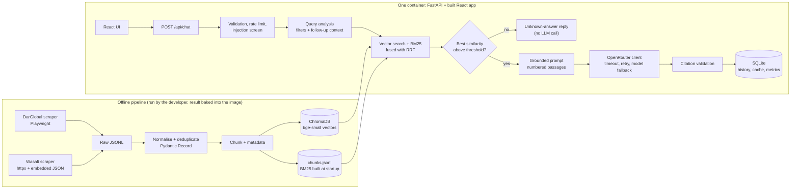

# PropIntel AI: Real Estate Intelligence Assistant

A retrieval-augmented chatbot that answers real estate questions using public information collected from
[DarGlobal](https://www.darglobal.co.uk/) and [Wasalt.sa](https://wasalt.sa/). Every answer cites its
sources, says which website each fact came from, and declines to answer when the data does not cover the question.

Built for the DarGlobal Junior AI Engineer (Applied AI) technical assignment.

| | |
|---|---|
| **Live application** | _Not deployed yet. See [Deployment](#deployment); the URL goes here once the public instance has been verified._ |
| **API documentation** | `/api/docs` (Swagger UI) on any running instance |
| **Evaluation report** | [backend/eval/REPORT.md](backend/eval/REPORT.md) |
| **Build log and status** | [IMPLEMENTATION_STATUS.md](IMPLEMENTATION_STATUS.md) |

## What it does

- Answers questions about DarGlobal developments, locations, amenities and press announcements, and about Wasalt property listings.
- Hybrid retrieval: dense vectors and BM25 keyword search, merged with Reciprocal Rank Fusion, plus metadata filters for price, bedrooms and sale/rent.
- Grounded generation through a free OpenRouter model, with a fallback chain of models and a no-LLM degraded mode.
- Numbered citations that are validated after generation, with source cards linking to the original page.
- Conversation history, follow-up questions, clear chat, suggested questions.
- Refuses out-of-scope questions before calling the model, and screens prompt-injection attempts.
- Rate limiting, input validation, response cache, structured JSON logs, latency and token metrics.

## Architecture



**Request flow.** A question is validated and screened, then analysed for a source name, price or bedroom
limits and sale/rent intent. Short or pronoun-led questions are combined with the previous user question so
follow-ups retrieve the right documents. Vector search and BM25 each return their top 20 chunks; RRF merges
the two rankings; the top 6 go into the prompt as numbered passages. If the best semantic match is below the
relevance threshold the service answers "I don't have that" without calling the model. Otherwise the model
answers from the passages only, and any citation number that does not match a supplied passage is removed
before the response is returned.

## Technology choices

| Layer | Choice | Why |
|---|---|---|
| API | FastAPI, Pydantic v2 | Typed request/response schemas, automatic OpenAPI docs, async I/O for the LLM call |
| Scraping | Playwright (DarGlobal), httpx (Wasalt) | DarGlobal only renders for a real browser; Wasalt ships its data as JSON in the HTML |
| Embeddings | FastEmbed, `BAAI/bge-small-en-v1.5` | Same sentence-transformer weights on ONNX Runtime; no PyTorch, so the app fits a 512 MB container |
| Vector store | ChromaDB (embedded) | Metadata filtering and persistence without running a separate database service |
| Keyword search | `rank-bm25`, rebuilt in memory at startup | Exact names (DG1, Al-Mahdiyah, Pagani) that embeddings blur; no second index file to keep in sync |
| Fusion | Reciprocal Rank Fusion | Uses ranks only, so cosine and BM25 scores need no normalisation |
| LLM | OpenRouter free models, ordered fallback chain | Free tier is rate-limited; one model is a single point of failure |
| State | SQLite | Sessions, cache and metrics for one instance; Redis would be a second service with no benefit here |
| Frontend | React, TypeScript, Tailwind, Vite | Served by FastAPI from the same origin: one container, one URL, no CORS |

Two deviations from the suggested stack, both for the free hosting tier: FastEmbed instead of the
`sentence-transformers` package (same model, a fraction of the memory), and no reranker (it would add
memory and latency, and retrieval already places a relevant chunk in the top 6 for every test question).

## Data collection and compliance

| Source | Method | Collected | Notes |
|---|---|---|---|
| DarGlobal | Playwright Chromium, no stealth plugins, one page every ~1.2 s | 38 projects, 14 press releases, 9 corporate pages | `robots.txt` is read through the browser and enforced per URL |
| Wasalt.sa | httpx, URL discovery from the public sitemap only | 21 apartment listings in Al-Mahdiyah, Riyadh | See limitation below |

Rules the scrapers follow:

- `robots.txt` is parsed (including `*` and `$` wildcards) and checked before every request.
- Wasalt's [`llms.txt`](https://wasalt.sa/llms.txt) is respected: no `/search` pages, no phone numbers,
  WhatsApp links, owner or advertiser names (they are removed before anything is written to disk, and a test
  enforces it), attribution as "Source: Wasalt.sa", and answers remind users to confirm prices on the live site.
- If a site answers with HTTP 403, a CAPTCHA or a block page, the scraper raises `BlockedError` and stops.
  There is no retry with a different identity.

### Known data limitations

1. **Wasalt coverage is narrow.** Wasalt's Cloudflare protection answered the scraper's HTTP client with a
   managed challenge (HTTP 403). The scraper stopped as designed and no workaround was attempted. The 21
   listings in the index come from one listing page that was served normally during the initial site
   inspection: the listing itself plus the 20 "similar properties" shown on that page. They are real, but all
   are apartments for sale in one Riyadh district. `python -m app.scrapers.wasalt --from-html <folder>`
   parses listing pages saved from a normal browser session, which is the compliant way to widen coverage.
2. **DarGlobal press releases: 14 of 72.** The press list paginates through client-side requests; the
   scraper collects the first page (the most recent releases) only.
3. **No prices for most DarGlobal projects.** The public project pages rarely state a price, so the
   assistant says so instead of estimating.
4. One derived document per country ("DarGlobal projects in Oman", and so on) is generated from the
   project names and locations on the public projects page. It adds no facts; it lets "which projects are
   in X" be answered from one passage instead of a dozen.

## Reliability features

| Concern | Implementation |
|---|---|
| Hallucination prevention | Answer only from numbered passages; relevance gate skips the LLM when nothing matches; citations validated against the passages actually sent |
| Unknown answers | Fixed refusal when retrieval is weak; model refusals are detected and returned without sources |
| Prompt injection | Input pattern screen, retrieved text delimited and declared untrusted in the system prompt, output citation check |
| LLM failures | Per-model timeout, one retry on transient errors with backoff, next model on failure, extractive "degraded" answer if all fail |
| Abuse and quota | Sliding-window rate limit per client IP (12 requests/minute), 600-character question limit |
| Caching | First-turn questions cached for 24 hours; follow-ups are never cached because their meaning depends on the conversation |
| Observability | JSON logs with request ids; per-request retrieval/LLM/total latency, token counts, model used, outcome; `/api/admin/metrics` |
| Data freshness | Every record stores `scraped_at`; shown on each source card and in the sidebar; `/api/knowledge-base` |
| Incremental ingestion | Content hash per record: unchanged chunks are not re-embedded, removed records are deleted from the index |

## Run it

### Docker (recommended)

```bash
cp .env.example .env          # add your OPENROUTER_API_KEY
docker compose up --build     # http://localhost:8000
```

The image builds the frontend, installs the backend, downloads the embedding model and builds the vector
index, so the container starts with a ready knowledge base. Without an API key the app still runs and
returns retrieved passages in degraded mode.

### Local development

```bash
# backend
cd backend
python -m venv .venv && .venv/Scripts/activate      # macOS/Linux: source .venv/bin/activate
pip install -r requirements-dev.txt
python -m app.ingestion.pipeline                    # build the index from data/raw
uvicorn app.main:app --reload --port 8000

# frontend (second terminal)
cd frontend
npm install
npm run dev                                         # http://localhost:5173, proxies /api to :8000
```

On Windows set `HF_HUB_DISABLE_XET=1` before the first run if the embedding model download fails.

### Refresh the data

```bash
cd backend
python -m playwright install chromium
python -m app.scrapers.darglobal                    # writes data/raw/darglobal_pages.jsonl
python -m app.scrapers.wasalt                       # live crawl; stops if the site blocks it
python -m app.scrapers.wasalt --from-html DIR       # or parse listing pages saved from a browser
python -m app.ingestion.pipeline                    # re-embeds only what changed
```

### Tests and evaluation

```bash
cd backend
pytest                                              # 60 tests, offline, under a second
python -m eval.run_eval                             # retrieval + guardrails, no LLM calls
python -m eval.run_eval --generation                # full pipeline, uses the OpenRouter quota
python -m eval.render_report                        # writes eval/REPORT.md from eval/results.json
```

## Configuration

All settings are environment variables (see [.env.example](.env.example) and `backend/app/core/config.py`).

| Variable | Default | Purpose |
|---|---|---|
| `OPENROUTER_API_KEY` | empty | Required for generated answers |
| `OPENROUTER_MODELS` | `google/gemma-4-31b-it:free,nvidia/nemotron-3.5-super-vl:free,openrouter/free` | Fallback chain, tried in order |
| `ADMIN_TOKEN` | empty | When set, `/api/admin/*` requires the `X-Admin-Token` header |
| `MIN_RELEVANCE` | `0.62` | Cosine similarity below which the assistant declines to answer |
| `RATE_LIMIT_PER_MINUTE` | `12` | Chat requests per client IP |
| `STATE_DIR` | data directory | Where SQLite lives; mount a volume here to keep chat history |

## API

| Method | Path | Purpose |
|---|---|---|
| POST | `/api/chat` | Ask a question: `{"question": "...", "session_id": "..."}`; returns answer, outcome, sources, model, usage, timings |
| GET | `/api/sessions/{id}/messages` | Conversation history |
| DELETE | `/api/sessions/{id}` | Clear a conversation |
| GET | `/api/health` | Health check: index size, LLM configured, index build time |
| GET | `/api/sources` | Browse indexed documents, filter by `source` and `doc_type` |
| GET | `/api/knowledge-base` | Document counts and collection dates per source |
| GET | `/api/admin/ingestion-status` | Full ingestion manifest |
| GET | `/api/admin/metrics` | Latency percentiles, tokens, cache hits, outcomes |

`outcome` is one of `answered`, `unknown`, `greeting`, `blocked` or `degraded`.

## Sample questions

- Which projects does DarGlobal have in Oman?
- What amenities does Trump Tower Jeddah offer?
- What did DarGlobal announce about Jeddah in November 2026?
- What do ROI, ROE and ROL mean according to DarGlobal?
- Show me 3-bedroom apartments for sale in Riyadh under SAR 800,000
- Which 4-bedroom apartments on Wasalt cost at most 800k SAR?
- Follow-up: "Tell me about Les Vagues", then "Who designed its interiors?"
- Out of scope: "What is the mortgage rate in Saudi Arabia?" (it should decline)

## Evaluation summary

Measured by `eval/run_eval.py` on a 40-question test set; full detail and method in
[backend/eval/REPORT.md](backend/eval/REPORT.md).

| Retriever (top 6) | Hit rate | Recall | Context precision | MRR |
|---|---|---|---|---|
| Vector only | 100.0% | 96.5% | 39.1% | 0.946 |
| BM25 only | 88.5% | 85.9% | 34.6% | 0.777 |
| Hybrid (RRF + filters) | 100.0% | 97.4% | 44.9% | 0.926 |

- Out-of-scope questions refused before the LLM: 5 of 5. Answerable questions passed through: 26 of 26.
- Prompt-injection attempts blocked: 4 of 4, with 0 of 36 normal questions wrongly blocked.
- On this corpus hybrid search gives the best recall and precision, while vector-only ranks the first
  relevant chunk slightly higher. The gain from BM25 and filters is concentrated in listing queries with
  numeric constraints.
- Generated-answer metrics (faithfulness, citation correctness, hallucination rate, latency) are reported
  in the evaluation report once the generation run has been executed with an API key.

## Deployment

The repository includes a [`render.yaml`](render.yaml) blueprint for Render's free web service tier:

1. Push this repository to GitHub.
2. In Render: New, Blueprint, select the repository.
3. Enter `OPENROUTER_API_KEY` when prompted. `ADMIN_TOKEN` is generated automatically.
4. Wait for the build, then open `https://<service>.onrender.com/api/health`.

Operational notes:

- **Free tier behaviour:** the service sleeps after 15 minutes without traffic and takes about a minute to
  wake. The knowledge base is inside the image, so nothing is lost on restart; chat history and metrics
  reset because the free tier has no persistent disk.
- **Secrets:** only in the host's environment settings. `.env` is git-ignored and excluded from the image.
- **Logs:** JSON lines on stdout, visible in the host's log viewer. Each response carries `X-Request-ID`.
- **Updates:** re-run the scrapers and the ingestion pipeline, commit `backend/data/raw/*.jsonl`, push. The
  host rebuilds the image and the index.

## Project structure

```
backend/
  app/
    api/routes.py           HTTP endpoints
    core/                   settings, JSON logging
    models/                 Record/Chunk and API schemas
    scrapers/               base utilities, darglobal.py, wasalt.py
    ingestion/              normalize.py, chunk.py, pipeline.py
    retrieval/              embedder.py, bm25.py, query.py, hybrid.py
    llm/                    openrouter.py, prompts.py
    services/               chat.py, guardrails.py, ratelimit.py, store.py
    main.py                 app factory and startup wiring
  data/raw, data/processed  scraped and normalised data (committed)
  eval/                     dataset.jsonl, run_eval.py, render_report.py, REPORT.md
  tests/                    60 offline tests
frontend/src/               App.tsx, components/, api.ts, storage.ts
Dockerfile, docker-compose.yml, render.yaml, .env.example
```
